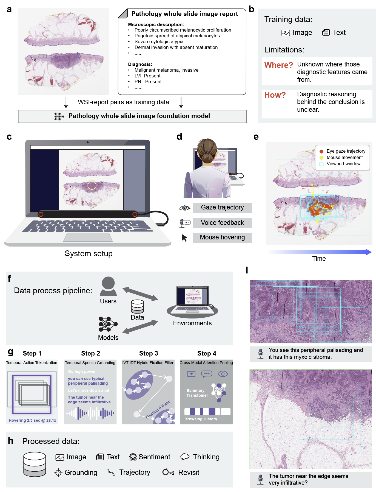
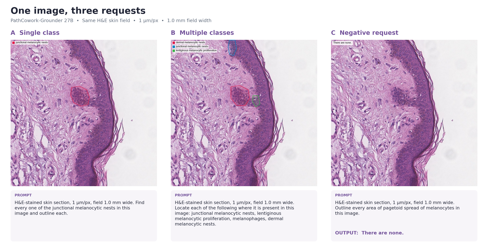
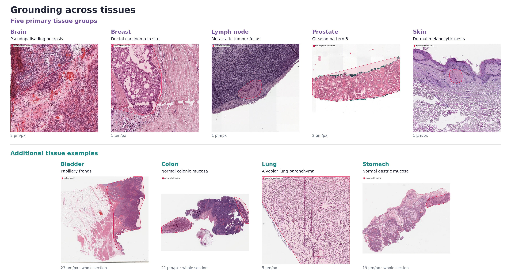

# PathCowork

**PathCowork: Shadowing Pathologists to Learn Diagnostic and Research Reasoning from Gaze, Voice, and Interaction**

## What Is PathCowork

PathCowork is a multimodal platform that lets AI "shadow" expert pathologists during whole-slide image review, so models can learn not only final diagnoses but also the diagnostic process.

Instead of training only on static slide-report pairs, PathCowork synchronizes four behavioral streams during routine work: viewport navigation, eye gaze, voice reasoning, and interaction logs (including AI-assist tool usage). These signals are processed into structured supervision, including spatial grounding, trajectories, revisitation patterns, and aligned text/thinking traces. The goal is to close the analysis-navigation gap: helping AI learn both where to look and how to reason.

## Main Manuscript Figure

## PathCowork-Grounder

[**Download PathCowork-Grounder-27B (GGUF) on Hugging Face**](https://huggingface.co/sheng-wang/pathcowork-grounder-27B-GGUF)

PathCowork-Grounder localizes histological features in H&E images from natural-language requests. Give it an image and ask it to outline a finding, and it returns labeled regions that can be overlaid on the image. The released 27B model is post-trained from the Qwen family and distributed in GGUF format.

- **One or several concepts per request:** locate a single finding or ask for multiple features in the same image.
- **Structured spatial output:** return a JSON list of labeled polygons or polylines, using integer coordinates on a normalized 0–1000 grid (x increases rightward; y increases downward).
- **Absent findings:** return `There are none.` when the requested feature is absent.
- **Five primary tissue groups:** brain, breast, lymph node, prostate needle biopsy and skin. Targets include microvascular proliferation, ductal carcinoma in situ, metastatic tumour foci, Gleason patterns and melanocytic features, as well as boundaries such as the dermoepidermal junction.
- **Additional tissue examples:** the model card illustrates localization of bladder papillary fronds, normal colonic mucosa, alveolar lung parenchyma and normal gastric mucosa.

### One image, three requests

Single-class, multiple-class and negative requests on the same skin field, with the three prompts and original model outputs.

### Grounding across tissues

**First row: Five primary tissue groups.** Brain, breast, lymph node, prostate and skin. **Second row: Additional tissue examples.** Bladder, colon, lung and stomach. All panels retain the original result overlays.

See the [Hugging Face model card](https://huggingface.co/sheng-wang/pathcowork-grounder-27B-GGUF#4-trained-organs-and-target-concepts) for the full target-concept list, illustrated examples and output formats.

## Repository Structure

- `viewer/`: whole-slide viewer app and runtime capture entrypoint
- `processors/viewport/`: viewport denoising, keyframe extraction, stable navigation segments
- `processors/gaze/`: gaze cleaning, fixation/saccade parsing, attention grounding
- `processors/voice/`: offline/online ASR pipeline and transcript alignment
- `processors/interaction/`: interaction/tool-log normalization
- `processors/mouse/`: mouse trajectory processing and hover/click event extraction
- `processors/revisit/`: revisit detection from viewport/mouse traces (heuristic module, evolving)
- `final_outputs/`: converts processed segment signals into human learning material, machine datasets, and QA benchmarks
- `schemas/`: unified JSON contracts shared across all processors
- `history/`: lightweight shareable case-history bundle (`seg_*_raw.json` + `seg_*_union.webp`)
- `streamlit_app.py`: Streamlit debugging UI for history/segment browsing and on-demand gaze rendering
- `videos/`: raw and example recordings, logs, and derived artifacts
- `image-2.png`: main manuscript figure

## Data Product Strategy

PathCowork standardizes multimodal traces into a unified event representation for agent-style training.

- Viewport output: tool-use style events (`zoom`, `pan`, `inspect`, `peek`) + stable keyframes + revisit candidates
- Gaze output: tool-use style events (`highlight`) aligned to viewport context
- Interaction output: tool-use style events for AI-assist or user-invoked tools
- Voice output: aligned transcript/thought text (not forced into tool-use)
- Mouse output: movement/hover/click traces supporting revisit and intent inference

See `schemas/README.md` and `schemas/unified_event.schema.json` for the common format.

## Gaze Rendering Note

For IVT-IDT fixation comparison panels and manuscript-ready gaze/boundary overlays, see:
- `processors/gaze/README.md`
- `processors/gaze/GazeData.py`

By default, gaze overlays are rendered without any `union.png` crop fix.
If a dataset has canvas-border artifacts, crop can be enabled manually via
`canvas_crop_insets=(top, bottom, left, right)`.

## History Bundle Format

`history/` uses neutral case identifiers (`case_001` to `case_005`) and is designed to stay compact and shareable:
- Required per segment:
  - `seg_xxxx_raw.json`
  - `seg_xxxx_union.webp` (lossy WebP, currently q=85)
- JSON stays small and portable; image payload is compressed for Git sharing.
