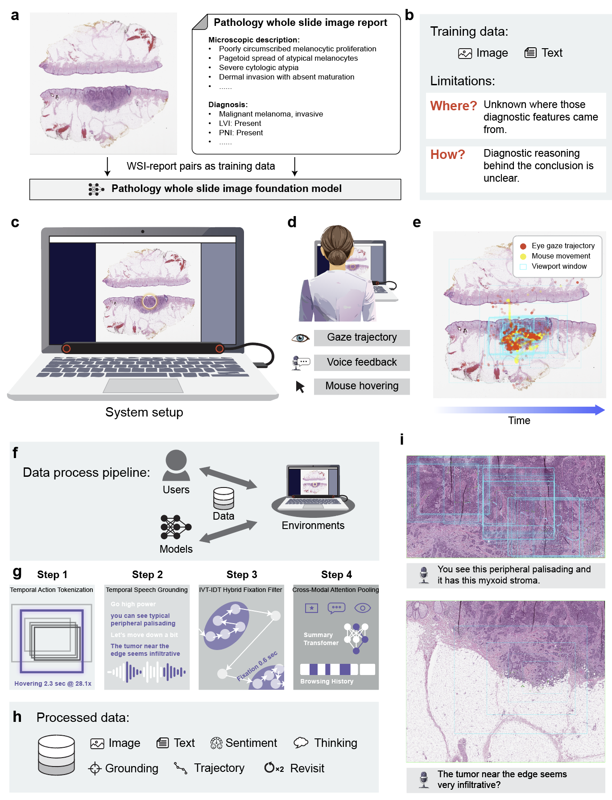
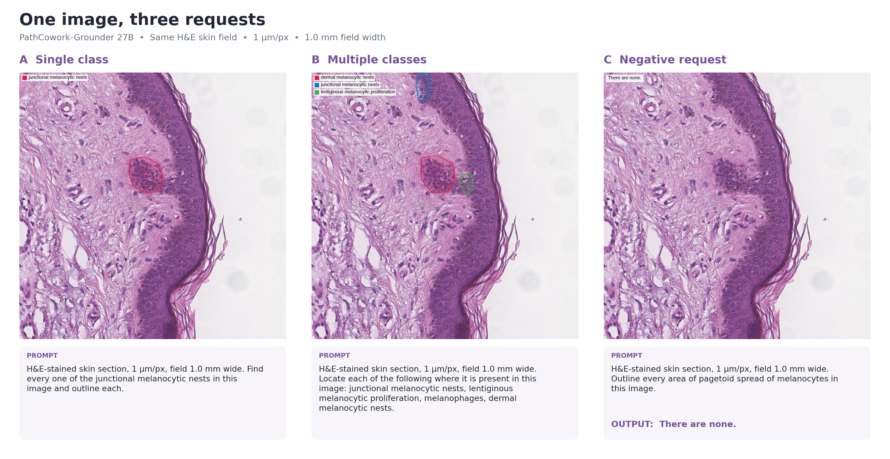
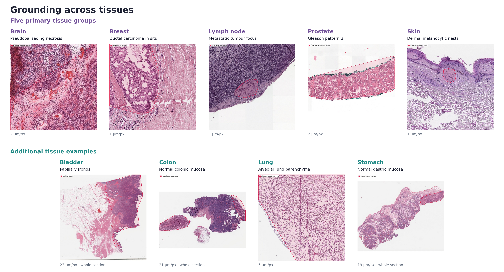

# PathCowork: Learning from real-world pathology practice to build AI copilots

## What Is PathCowork

PathCowork is a multimodal platform that lets AI "shadow" expert pathologists during whole-slide image review, so models can learn not only final diagnoses but also the diagnostic process.

Instead of training only on static slide-report pairs, PathCowork synchronizes four behavioral streams during routine work: viewport navigation, eye gaze, voice reasoning, and interaction logs (including AI-assist tool usage). These signals are processed into structured supervision, including spatial grounding, trajectories, revisitation patterns, and aligned text/thinking traces. The goal is to close the analysis-navigation gap: helping AI learn both where to look and how to reason.

## Videos

- **[Main Video 1: Interactive whole-slide review](videos/01_Main_Video_1_Agent.mp4)**: PathCowork examines a skin slide, localizes evidence and records findings. Updated recording with cleaned narration audio. [English subtitles](videos/01_Main_Video_1_Agent.en.srt).
- **[Video 2: Capturing pathologist behavior](videos/02_Video_2_Behavior_Acquisition.mp4)**: Gaze, navigation and spoken observations during skin-biopsy review. [English subtitles](videos/02_Video_2_Behavior_Acquisition.en.srt).
- **[Supplementary Video 3: Learned navigation](videos/03_Supplementary_Video_3_General_Navigation.mp4)**: PathCowork-general navigates a lymph-node slide using a learned viewing policy.

[Full video descriptions](videos/Video_legends.txt).

## Main Manuscript Figure




## PathCowork-Grounder

[**Download PathCowork-Grounder-27B (GGUF) on Hugging Face**](https://huggingface.co/zhihuanglab/pathcowork-grounder-27B-GGUF)

[**Download PathCowork-Grounder-Pro-1T (LoRA adapter) on Hugging Face**](https://huggingface.co/zhihuanglab/pathcowork-grounder-pro-1T)

PathCowork-Grounder localizes histological features in H&E images from natural-language requests. Give it an image and ask it to outline a finding, and it returns labeled regions that can be overlaid on the image. The released 27B model is post-trained from the Qwen family and distributed in GGUF format.

- **One or several concepts per request:** locate a single finding or ask for multiple features in the same image.
- **Structured spatial output:** return a JSON list of labeled polygons or polylines, using integer coordinates on a normalized 0–1000 grid (x increases rightward; y increases downward).
- **Absent findings:** return `There are none.` when the requested feature is absent.
- **Five primary tissue groups:** brain, breast, lymph node, prostate needle biopsy and skin. Targets include microvascular proliferation, ductal carcinoma in situ, metastatic tumour foci, Gleason patterns and melanocytic features, as well as boundaries such as the dermoepidermal junction.
- **Additional tissue examples:** the model card illustrates localization of bladder papillary fronds, normal colonic mucosa, alveolar lung parenchyma and normal gastric mucosa.

### One image, three requests

Single-class, multiple-class and negative requests on the same skin field, with the three prompts and original model outputs.



### Grounding across tissues

**First row: Five primary tissue groups.** Brain, breast, lymph node, prostate and skin. **Second row: Additional tissue examples.** Bladder, colon, lung and stomach. All panels retain the original result overlays.



See the [Hugging Face model card](https://huggingface.co/zhihuanglab/pathcowork-grounder-27B-GGUF#4-trained-organs-and-target-concepts) for the full target-concept list, illustrated examples and output formats.

## System requirements and tested environments

The PathCowork interface was tested on macOS 26 and macOS 27 using Google Chrome. The tested hardware included an Apple M5 Pro Mac with 64 GB of unified memory. Windows browser compatibility has not been tested for this release.

The current reference local software configuration, recorded on 11 November 2026, is:

| Component | Version or configuration |
|---|---|
| Browser | Google Chrome 157.0.8103.39 |
| Local model application | LM Studio 0.4.21+2 |
| Selected GGUF inference runtime | LM Studio llama.cpp Metal runtime 2.62.1 |
| Local machine | Apple M5 Pro, 64 GB unified memory |

The runtime number above identifies the llama.cpp runtime package distributed by LM Studio.

The [TissueLab viewer and service](https://github.com/zhihuanglab/TissueLab) use Node.js 24 or later and Python 3.11. Platform dependencies are documented in the [TissueLab Quick Start](https://github.com/zhihuanglab/TissueLab#-quick-start), with versioned Python requirements for [macOS](https://github.com/zhihuanglab/TissueLab/blob/main/app/service/requirements-macos.txt), [Windows](https://github.com/zhihuanglab/TissueLab/blob/main/app/service/requirements-windows.txt) and [Linux](https://github.com/zhihuanglab/TissueLab/blob/main/app/service/requirements-linux.txt). The viewer/service environment and the model inference backend are installed separately. Processing-script usage and dependencies are described in [processors/README.md](processors/README.md).

### Processing dependencies

Use Python **3.12.11** for the processing scripts in this repository. Install the core requirements and add the optional groups needed for your workflow:

| Function | Packages and versions | Dependency file |
|---|---|---|
| Core visualization and output generation | NumPy 2.2.6, matplotlib 3.10.5, Pillow 11.3.0 | [requirements.txt](requirements.txt) |
| OpenAI transcription and OpenAI/Gemini generation | openai 1.101.0, google-genai 1.57.0 | [requirements-api.txt](requirements-api.txt) |
| Streamlit history browser | streamlit 1.67.0 | [requirements-ui.txt](requirements-ui.txt) |
| Local voice transcription | faster-whisper 1.2.1, PyAV 14.4.0 | [requirements-voice.txt](requirements-voice.txt) |

The core and API package versions match the recorded local conda environment. The optional UI and local-voice versions define the reference installation for those features.

From the repository root:

```bash
conda create -n pathcowork python=3.12.11
conda activate pathcowork
python -m pip install -r requirements.txt

# Install the optional groups you need:
python -m pip install -r requirements-api.txt
python -m pip install -r requirements-ui.txt
python -m pip install -r requirements-voice.txt
```

The [complete macOS/Python 3.12 dependency snapshot](requirements-macos-py312.lock.txt) records the resolved versions, including transitive dependencies, for the core and all three optional groups. Install it with `python -m pip install -r requirements-macos-py312.lock.txt` to reproduce that Python environment. This environment is separate from TissueLab's Python 3.11 service and the model-serving runtimes.

Local faster-whisper transcription uses PyAV's bundled FFmpeg libraries; a separate system FFmpeg installation is not required. Its optional NVIDIA GPU backend requires CUDA 12/cuBLAS and cuDNN 9, as described in the [faster-whisper requirements](https://github.com/SYSTRAN/faster-whisper#requirements). CPU transcription does not require CUDA. API-backed features require the relevant service credentials; the core visualization and Streamlit browser do not require an API key.

### Model hardware

**27B local inference.** The tested local hardware is the Apple M5 Pro Mac with 64 GB of unified memory described above. The [Q4_K_M model](https://huggingface.co/zhihuanglab/pathcowork-grounder-27B-GGUF/tree/main) is approximately 16.81 GB and its vision projector is approximately 0.93 GB, requiring approximately 17.74 GB of storage together. Inference additionally uses memory for context, image processing and runtime buffers. NVIDIA GPU deployment can use a compatible llama.cpp CUDA backend. Memory requirements vary with context length and inference settings.

**1T server inference.** [PathCowork-1T](https://huggingface.co/zhihuanglab/pathcowork-grounder-pro-1T) is a rank-32 PEFT/LoRA adapter for `moonshotai/Kimi-K2.6`; the base model is required in addition to the adapter. The [upstream Kimi-K2.6 deployment guide](https://huggingface.co/moonshotai/Kimi-K2.6/blob/main/docs/deploy_guidance.md) provides a reference configuration using eight NVIDIA H200 GPUs on one node with tensor parallelism of eight, using vLLM or SGLang. Serving PathCowork-1T also requires loading its adapter with a compatible serving configuration. Memory requirements depend on weight precision, context length, concurrency and adapter handling. A machine accessing a remote inference endpoint does not need to host the model weights itself.

## Viewer and model setup

### TissueLab viewer

Follow the [TissueLab Quick Start](https://github.com/zhihuanglab/TissueLab#-quick-start) for the platform installation and startup commands. On macOS, the basic setup is:

```bash
git clone https://github.com/zhihuanglab/TissueLab.git
cd TissueLab/app
npm install
cd render
npm install
cd ../service
conda create -n tissuelab python=3.11
conda activate tissuelab
pip install -r requirements-macos.txt
```

For slide formats requiring libvips, follow TissueLab's slide-reader setup instructions. Start the Python service with `python main.py` from `TissueLab/app/service`. In a separate terminal, run `npm run dev` from `TissueLab/app/render` and open `http://localhost:3000` in Chrome. The upstream guide also describes the Electron desktop interface.

### 27B model in LM Studio

1. Install [LM Studio](https://lmstudio.ai/download) and select its llama.cpp runtime for GGUF inference. The current reference Mac configuration uses the Metal runtime listed above.
2. Obtain both files from the [27B model repository](https://huggingface.co/zhihuanglab/pathcowork-grounder-27B-GGUF/tree/main):
   - `pathcowork-grounder-27B-Q4_K_M.gguf`
   - `mmproj-pathcowork-grounder-27B-f16.gguf`
3. Load the model with its matching vision projector. The projector is required for image input.
4. Enable LM Studio's local API server when accessing the model from another application. Use the server address and model identifier shown by LM Studio.

The [model card](https://huggingface.co/zhihuanglab/pathcowork-grounder-27B-GGUF) supplies image-and-text prompt examples and expected polygon/polyline output formats. For a standalone llama.cpp server, consult its [multimodal loading instructions](https://github.com/ggml-org/llama.cpp/blob/master/docs/multimodal.md), which describe the model and `--mmproj` arguments.

### 1T model on a server

Obtain the [Kimi-K2.6 base model](https://huggingface.co/moonshotai/Kimi-K2.6) and the [PathCowork-1T adapter](https://huggingface.co/zhihuanglab/pathcowork-grounder-pro-1T). Follow the upstream base-model deployment guide for the server environment, then use a serving configuration that loads the PathCowork adapter. Configure the endpoint to serve the base model with the PathCowork adapter enabled.

### Installation time

Estimated installation time for the llama.cpp inference backend is approximately **10 minutes**, assuming the required system dependencies are already installed. This estimate excludes model downloads, operating-system or GPU-driver installation, TissueLab setup and deployment of the 1T server. Download time depends on model size and network speed.

## Demonstration and expected runtime

The [single-skin-whole-slide demonstration](videos/01_Main_Video_1_Agent.mp4) shows tissue inspection, localization of histological findings and recording of findings with visual evidence. Allow approximately **2-3 minutes** for the demonstrated workflow after setup. This is an illustrative runtime estimate; time varies with the selected model, inference backend, hardware, network latency and slide content. Installation and model downloads are excluded.

Expected outputs include localized findings and their visual evidence; the grounder returns labeled polygons or polylines on a normalized 0-1000 coordinate grid, or `There are none.` for an absent finding. See the [model examples](https://huggingface.co/zhihuanglab/pathcowork-grounder-27B-GGUF) and [video descriptions](videos/Video_legends.txt).


## Repository Structure

- [TissueLab](https://github.com/zhihuanglab/TissueLab): whole-slide viewer and recording platform maintained in a separate repository
- `processors/viewport/`: viewport denoising, keyframe extraction, stable navigation segments
- `processors/gaze/`: gaze cleaning, fixation/saccade parsing, attention grounding
- `processors/voice/`: offline/online ASR pipeline and transcript alignment
- `processors/interaction/`: interaction/tool-log normalization
- `processors/mouse/`: mouse trajectory processing and hover/click event extraction
- `processors/revisit/`: revisit detection from viewport/mouse traces (heuristic module, evolving)
- `final_outputs/`: converts processed segment signals into human learning material, machine datasets, and QA benchmarks
- `schemas/`: unified JSON contracts shared across all processors
- `history/`: lightweight shareable case-history bundle (`seg_*_raw.json` + `seg_*_union.webp`)
- `streamlit_app.py`: Streamlit debugging UI for history/segment browsing and on-demand gaze rendering
- `videos/`: three demonstration videos, English subtitles and video descriptions
- `image-2.png`: main manuscript figure

## Data Product Strategy

PathCowork standardizes multimodal traces into a unified event representation for agent-style training.

- Viewport output: tool-use style events (`zoom`, `pan`, `inspect`, `peek`) + stable keyframes + revisit candidates
- Gaze output: tool-use style events (`highlight`) aligned to viewport context
- Interaction output: tool-use style events for AI-assist or user-invoked tools
- Voice output: aligned transcript/thought text (not forced into tool-use)
- Mouse output: movement/hover/click traces supporting revisit and intent inference

See `schemas/README.md` and `schemas/unified_event.schema.json` for the common format.

## Gaze Rendering Note

For IVT-IDT fixation comparison panels and manuscript-ready gaze/boundary overlays, see:
- `processors/gaze/README.md`
- `processors/gaze/GazeData.py`

By default, gaze overlays are rendered without any `union.png` crop fix.
If a dataset has canvas-border artifacts, crop can be enabled manually via
`canvas_crop_insets=(top, bottom, left, right)`.

## History Bundle Format

`history/` uses neutral case identifiers (`case_001` to `case_005`) and is designed to stay compact and shareable:
- Required per segment:
  - `seg_xxxx_raw.json`
  - `seg_xxxx_union.webp` (lossy WebP, currently q=85)
- JSON stays small and portable; image payload is compressed for Git sharing.

